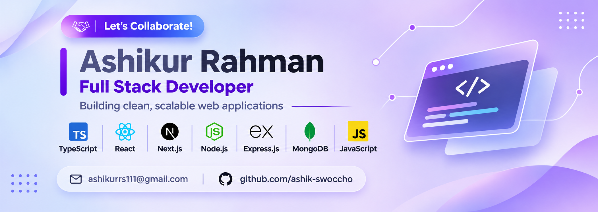

<!-- ==================== BANNER ==================== -->

  

<!-- ==================== INTRODUCTION ==================== -->

<h1 align="center">Hi 👋, I'm Ashikur Rahman</h1>

<h3 align="center">
  A passionate Full Stack Developer
</h3>

  

  

<!-- ==================== ABOUT ME ==================== -->

## 👨‍💻 About Me

- 💻 I'm a Full Stack Developer passionate about building modern web applications.
- 🌱 I'm currently learning **TypeScript, PostgreSQL, Node.js and Express.js**.
- ⚛️ I work with React and Next.js to build responsive user interfaces.
- ⚙️ Interested in backend development, REST APIs and database management.
- 🚀 Always exploring new technologies and improving my development skills.
- 🤝 Open to collaborating on interesting web development projects.
- 📫 Reach me at **ashikurrs111@gmail.com**

<!-- ==================== CONNECT ==================== -->

## 🌐 Connect with Me

<!-- ==================== TECHNOLOGY STACK ==================== -->

## 🛠️ Technology Stack

### Languages

  
  

### Frontend Development

  
  

### Backend Development

  
  

### Database

  

<!-- ==================== GITHUB STATISTICS ==================== -->

## 📊 GitHub Statistics

  
  

  

<!-- ==================== FOOTER ==================== -->

  <i>Building, learning and growing one commit at a time. 🚀</i>

